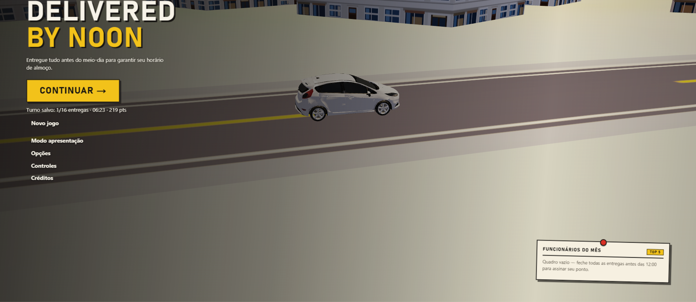
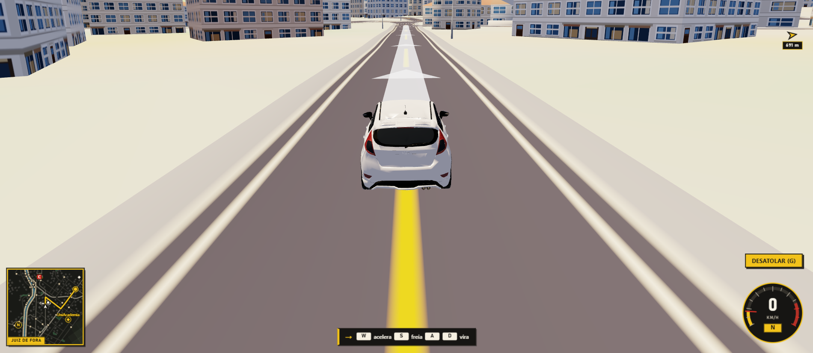
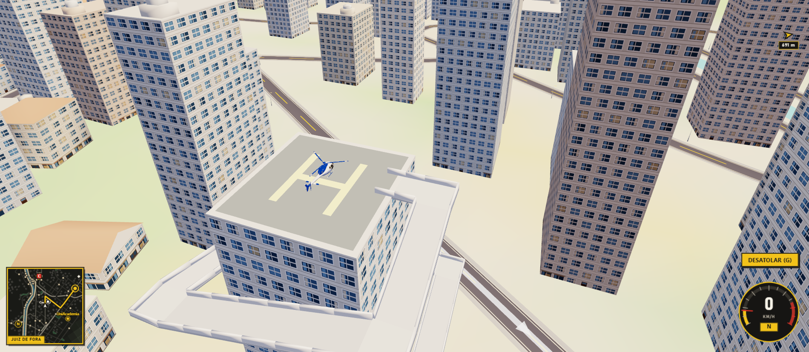
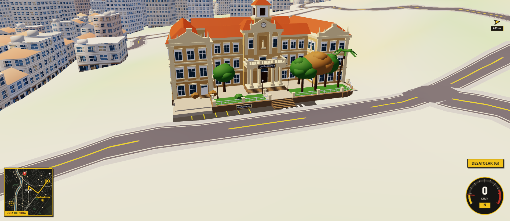

# Delivered by Noon

**Entregue tudo antes do meio-dia — ou perca seu horário de almoço.**

**▶ Jogar agora no navegador:** https://playcanv.as/p/TDvKBc0x/

---

## Descrição geral

**Enredo:** Você é um entregador da GoPostal em Juiz de Fora que começa o turno às **06:00** e tem até o horário de almoço (**12:00**) para completar as **16 entregas** da manhã. A progressão é de veículos cada vez mais rápidos: Hatch → Esportivo → Helicóptero → avião A-29 Super Tucano (com lançamento aéreo das encomendas). Cada veículo já traz suas encomendas ao entrar nele; a última entrega de cada estágio leva o jogador ao próximo veículo, fechando na fachada histórica da **UniAcademia**.

**Objetivos:** Entregar todas as 16 encomendas antes das **12:00**. O relógio no HUD avança de **06:00 a 12:00** (30 minutos reais por padrão, ajustável no atributo `dayDurationMinutes`), sempre de dia enquanto o sol da manhã sobe sobre Juiz de Fora. **Vitória:** todas as entregas concluídas antes do meio-dia (com bônus de tempo e placar de recordes). **Derrota:** relógio chega a 12:00 com encomendas pendentes.

---

## Ferramenta utilizada

- **PlayCanvas** (Editor online + engine 2.x)
- **TypeScript** + **Vite** para build local e script ESM único
- **Blender** (headless, scripts em Python) para adaptar e otimizar os modelos 3D (GLB)
- **Meshy** (geração de modelos 3D por IA, recomendada pelo professor) para os carros do trânsito
- Mapa real de **Juiz de Fora** (OpenStreetMap + relevo AWS Terrain Tiles)

---

## Instalação e execução

**Requisitos:** Node.js 20 ou mais novo (testado no 24) e um navegador com WebGL 2 (Chrome, Edge ou Firefox atuais). Dependências instaladas pelo `npm install`: `playcanvas` (engine) e, para desenvolvimento, `typescript`, `vite`, `vitest` e `@gltf-transform/core`.

```bash
npm install
npm run dev        # abre http://localhost:5173 no Chrome
npm run build      # build de produção
npm test           # roda testes (vitest)
```

**Como jogar no Editor do PlayCanvas:** veja o guia completo em [`docs/editor.md`](docs/editor.md) — resume: `npm run build:editor` gera `dist-editor/flight-sim.mjs`; publique no Editor via API (`npm run publicar:editor`) ou upload manual; monte a cena com o snippet `scripts/montar-cena-editor.js` no Console (F12); clique **Launch**.

**Diagnóstico de desempenho:** adicione `?perf=1` à URL (ex.: `http://localhost:5173/?perf=1`) para registrar FPS médio, pior quadro, *draw calls* e *mesh instances* visíveis no console a cada 5 s.

---

## Controles

### Gerais
| Tecla | Ação |
|-------|------|
| **E** | Entrar / sair de veículo próximo |
| **C** / **V** | Alternar câmera (atrás / de cima / cabine) |
| **M** | Alternar Mouse / Teclado (aeronaves) |
| **Esc** / **P** | Pausar / menu de pausa |
| **G** | Desatolar (volta o veículo para a rua mais próxima) |
| **F8** | Modo dev: câmera livre para explorar o mapa (T traz o veículo) |

### A pé
| Tecla | Ação |
|-------|------|
| **W / A / S / D** | Andar |
| **Espaço** | Pular |
| **Mouse** | Girar câmera |
| **Clique esquerdo** | Travar/soltar ponteiro |

### Carro / Esportivo
| Tecla | Ação |
|-------|------|
| **W / A / S / D** | Dirigir |
| **Shift** | Nitro (Esportivo) |
| **Espaço** | Freio de mão / drift |
| **Mouse** | Girar câmera |

### Helicóptero
| Tecla | Ação |
|-------|------|
| **Shift / Ctrl** | Coletivo (subir / descer) |
| **W / A / S / D** | Inclinar (frente / trás / lados) |
| **Q / E** | Girar (leme / pedais) |
| **Mouse** | Girar câmera |

### A-29 Super Tucano
| Tecla | Ação |
|-------|------|
| **W / S** | Arfagem (nariz cima / baixo) |
| **A / D** | Rolagem (inclinação) |
| **Q / E** | Leme |
| **Shift / Ctrl** | Acelerador (+ / −) |
| **Espaço** | Lançamento aéreo (air-drop) |
| **F** | Liga / desliga fumaça na cauda |
| **R** | Reiniciar veículo atual |

---

## Capturas de tela

| | |
|---|---|
|  |  |
|  |  |

---

## Versão jogável

- **Link jogável (PlayCanvas):** https://playcanv.as/p/TDvKBc0x/
- **Projeto no PlayCanvas Editor:** https://playcanvas.com/editor/project/1606932
- **Rodar localmente:** `npm install` e `npm run dev`, depois abra http://localhost:5173 (ou `npm run build` + `npm run preview`).

---

## Estrutura do projeto

- `src/main.ts` — Ponto de entrada, inicializa app PlayCanvas e módulos
- `src/flight/types.ts` — Contrato compartilhado: `FlightState`, `MissionState`, `VehicleKind`, `Stage`, `FlightContext`
- `src/flight/noise.ts` — Ruído determinístico (valueNoise, fbm, rng, clamp01, smoothstep)
- `src/flight/world.ts` — Terreno procedural, mar, cidade, céu, nuvens; `groundAt(x, z)`
- `src/flight/world-data.ts` — Dados estáticos do mundo (spawns de veículos, pontos de entrega)
- `src/flight/vehicles.ts` — Gerenciador de veículos (spawn, enter/exit, troca de controle)
- `src/flight/car.ts` — Física arcade de carro (com variante tunada)
- `src/flight/foot.ts` — Movimento a pé (andar, pular, câmera)
- `src/flight/helicopter.ts` — Helicóptero: coletivo, cíclico, mira por mouse
- `src/flight/airplane.ts` — Modelo procedural do A-29 (caixas, hélice, pontas de asa)
- `src/flight/flight.ts` — Controlador de voo do A-29 (arcade + FDM híbrido)
- `src/flight/cameras.ts` — Rig de câmera: perseguição, topo, cabine por veículo
- `src/flight/cockpit.ts` — Painel 2D (horizonte artificial, velocímetro, altímetro, bússola, throttle)
- `src/flight/hud.ts` — HUD HTML: velocidade, altitude, throttle, relógio, entregas, score, atalhos
- `src/flight/game.ts` — Orquestração: missão, spawns, progressão de estágios, vitória/derrota
- `src/flight/ui/menus.ts` — Menus: pausa, intro, vitória, derrota, configurações
- `src/flight/ui/settings.ts` — Configurações persistidas (sensibilidade, inversão, etc.)
- `src/flight/audio/sound.ts` — Motor, ambiente, UI, fumaça
- `src/flight/smoke.ts` — Sistema de partículas de fumaça (A-29)
- `src/flight/fdm/` — Flight Dynamics Model derivado do JSBSim (PC-7 → A-29)
  - `model.ts` — Dinâmica de corpo rígido 6-DOF, atmosfera ISA, assistência arcade
  - `instructor.ts` — Guia de mira por mouse (horizontal + vertical)
  - `controller.ts` — Mistura teclado/mouse, resposta em taxa
  - `table.ts`, `atmosphere.ts` — Tabelas aerodinâmicas e atmosfera
  - `aircraft-pc7.json`, `aircraft-a29.json` — Dados do avião (polares, massa, inércia, motor)
  - `ground.ts`, `heli.ts` — Solo e helicóptero (FDM simplificado)
  - `LICENSE-JSBSim.txt` — Licença LGPL-2.1 do JSBSim
- `src/flight/models/` — Carregamento GLB (A-29, mundo, veículos)
- `src/editor/` — Scripts de build para o PlayCanvas Editor (ESM externo)
- `public/models/` — Assets GLB exportados do Blender
- `scripts/` — Scripts de automação (publicar no Editor, montar cena, exportar mundo)
- `docs/editor.md` — Guia de publicação no PlayCanvas Editor

---

## Integrantes

- João Victor da Costa
- Gabriel Monteiro
- Rafael Lima Henriques
- Lucas Tostes

---

## Créditos e licenças

A física de voo (FDM) foi portada e adaptada do **JSBSim** (LGPL-2.1, *JSBSim-Team*). Os arquivos derivados estão em `src/flight/fdm/` e a licença original em `src/flight/fdm/LICENSE-JSBSim.txt`. Nenhum código do FlightGear foi utilizado; é um subconjunto educacional com assistência arcade, não o motor JSBSim completo nem uma simulação validada do A-29.

- **PlayCanvas** — Engine 3D web
- **Blender** — Modelagem e adaptação 3D

### Modelos 3D de terceiros (adaptados pelo grupo: escala real, rodas/rotores separados, sem interior e sem logos)
- **2014 Ford Fiesta ST** — *Ddiaz Design* (https://sketchfab.com/3d-models/2014-ford-fiesta-st-44a06a21f2714c31b25a51c6a4ecd9df), licença **CC BY-NC-SA 4.0**; versão modificada distribuída sob a mesma licença (`public/models/carro.glb`). Rodas de 5 raios geradas no Meshy.
- **Porsche 911 GT3** — *ChevroletSS* (https://sketchfab.com/3d-models/porsche-911-gt3-78d5c47ab2554c2592b7e499179a0792), licença **CC BY 4.0** (`public/models/carro-tunado.glb`).
- **Animated civilian Helicopter** — *assetfactory* (https://sketchfab.com/3d-models/animated-civilian-helicopter-f25c041a8d004eb092e4aa41d1dc33f4), licença **Sketchfab Free Standard** (`public/models/helicoptero.glb`).
- **EMB-314 Super Tucano A29B** — *Gilberto (Gilhhjm)* (https://sketchfab.com/3d-models/emb-314-super-tucano-a29b-ad14e4e33ac4482998784249bb11d7f8), licença **Sketchfab Free Standard** (`public/models/a29.glb`).
- **Carros do trânsito** (hatch, picape, sedan) — gerados pelo grupo no **Meshy** e ajustados no Blender.
- **UniAcademia, personagem e cenário** — modelados pelo grupo (Blender e geração procedural).

- **QuickRoad (ideia dos cruzamentos)** — plugin do Roblox de *stravant* (GeomTools), licença **MIT** (https://devforum.roblox.com/t/new-geomtools-plugin-quickroad-is-finally-here/2024127). Usamos só a ideia (cortar cada rua num recuo calculado pelo ângulo e pela largura das vizinhas, miolo poligonal com filetes de esquina, meio-fio contornando a esquina); nenhum código do plugin foi copiado. Implementação própria em `src/flight/world-data.ts`.
- **carphysics2d** — Mike Linkovich (spacejack), baseado em *Car Physics for Games* de Marco Monster; licença **MIT** confirmada no repositório. Port SI com pneus por ângulo de deriva, transferência de peso e FWD/RWD: `src/flight/carphys/model.ts`; licença preservada em `src/flight/carphys/LICENSE-carphysics2d.txt`. Fonte: https://github.com/spacejack/carphysics2d/tree/1266b154fb79320db19d14874d6bdf0825687d44 . Assistências e parâmetros arcade não representam ensaio de automóvel real.
- **JSBSim FGRotor** — Jon S. Berndt, Thomas Kreitler e JSBSim-Team; **LGPL-2.1-or-later**. Subconjunto SI de empuxo/influxo e torque: `src/flight/fdm/rotor.ts`, integrado em `src/flight/fdm/heli.ts`; licença em `src/flight/fdm/LICENSE-JSBSim.txt`. Fonte: https://github.com/JSBSim-Team/jsbsim/blob/3f153c18a2518f8472e37c89e70444b1c671b700/src/models/propulsion/FGRotor.cpp .
- **Juiz de Fora (mapa do jogo)** — © colaboradores do OpenStreetMap, dados sob a licença **ODbL** (ruas, rio, praças, estádios, universidades, pista e bairros reais; https://www.openstreetmap.org/copyright). Relevo: **AWS Terrain Tiles** (Mapzen/terrarium, compilado de SRTM e outras fontes públicas; https://registry.opendata.aws/terrain-tiles/). Convertidos por `scripts/importar-jf.mjs` (escala 0,49, mapa girado ~5,4° para a pista ficar norte-sul) em `src/flight/jf-mundo.json`; prédios e casas são procedurais, não reais.
- **Parâmetros MD 500** — `src/flight/fdm/aircraft-md500.json`: dimensões públicas MD Helicopters (rotor 8,05 m, cinco pás, massa arredondada de 1.360 kg) e estimativas educacionais explicitadas, sem validação de desempenho real. Referência: https://www.mdhelicopters.com/wp-content/uploads/2023/04/MD_500E_Product_Spec.pdf . O AH-1S de Thomas Kreitler foi consultado para a organização rotor principal/cauda; sua configuração declara GPL e **não foi copiada** para os parâmetros LGPL deste subconjunto.
- **Engine Sim** — Yigit Salih Emecen; licença **MIT** confirmada no repositório. Núcleo de síntese procedural de motores por ordem de ignição (AudioWorklet inline / PeriodicWave, guias de onda de escapamento, abafador, ressonador de admissão e estouros de corte de giro/nitro) portado para TypeScript em `src/flight/audio/engine-sim-dsp.ts` e integrado em `src/flight/audio/sound.ts`; licença preservada em `src/flight/audio/LICENSE-engine-sim.txt`. Fonte: https://github.com/YigitSalihEmecen/Engine_Sim/tree/c3ff61031050f1fc280a864f4bb445f30aeaa0a3 .
