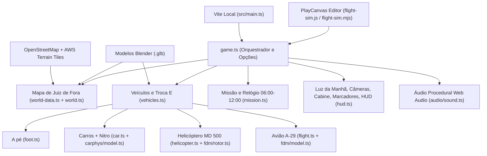

# Como o jogo funciona — Guia de estudo do grupo

Este documento explica, em linguagem simples e direta, cada parte técnica do jogo **Delivered by Noon** (ambientado em **Juiz de Fora — MG**). Use este guia para revisar antes da apresentação e responder perguntas da banca com segurança.

---

## Visão geral da arquitetura

O jogo é organizado em **módulos independentes** que conversam por um estado compartilhado (`FlightContext` em `src/flight/types.ts`). Quem liga tudo na ordem certa a cada quadro é `src/flight/game.ts`.

---

## 1. Motor PlayCanvas e cena do Editor

- **Onde fica no código:** `src/main.ts` (versão web local), `src/editor/flight-sim.ts` (script ESM para o Editor), `src/editor/flight-sim-classic.ts` (script clássico `pc.createScript`), `scripts/montar-cena-editor.js` (montagem da cena no Viewport).
- **O que faz:** O PlayCanvas fornece o motor 3D WebGL (grafo de entidades, componentes `render`/`model`, `camera`, `light`, `script`, leitura de teclado/mouse e loop de quadros `app.on('update')`). No Editor online, a cena já tem as entidades visíveis na Hierarchy (`Jogo`, `Mundo`, `A29`, `Heli`, `Carro_Inicial`, `Carro_Tunado`, `UniAcademia`, `CameraJogo`, `Sol`) e o script anexado em `Jogo` expõe **7 atributos editáveis no Inspector** (duração do dia, dificuldade, sensibilidade do mouse, volumes, minimapa e FPS) que atualizam o jogo ao vivo via evento `attr`.
- **Como explicar em 30 segundos:**
  > "Usamos o PlayCanvas 2.x tanto como motor 3D no navegador quanto no Editor online. A cena inteira — mundo de Juiz de Fora, veículos e a UniAcademia — é montada como entidades na Hierarchy com modelos GLB, e o script principal na entidade `Jogo` expõe 7 atributos editáveis no Inspector, permitindo ajustar dificuldade, duração do dia, áudio e contador de FPS ao vivo sem mexer no código."

---

## 2. `game.ts` — Ciclo do jogo, módulos e pausa

- **Onde fica no código:** `src/flight/game.ts` e o contrato compartilhado em `src/flight/types.ts`.
- **O que faz:** É o maestro do jogo. Ao iniciar (`startFlightSim`), reaproveita a cena do Editor se ela existir (ou constrói o mundo localmente), inicializa os módulos em **ordem fixa** (`veículos → missão → luz da manhã → câmeras → marcadores → cabine → HUD → fumaça`), aplica as opções vindas do Editor (dificuldade, duração do dia, FPS, minimapa) e controla os 4 estados do jogo: **título**, **jogando**, **pausado** e **fim (vitória/derrota)**. Na pausa (`Esc`/`P` ou soltar o mouse), nenhum módulo de física ou relógio roda — tudo congela exatamente onde estava. No `destroy()`, limpa listeners, áudio, DOM e restaura a cena do Editor sem vazar memória.
- **Como explicar em 30 segundos:**
  > "O `game.ts` centraliza o loop principal e mantém tudo desacoplado através de um estado único (`FlightState` e `MissionState`). Cada quadro roda na ordem exata — primeiro física e missão, depois luz, câmera e interface — para evitar atraso de câmera ou tremor. Quando o jogador pausa, o relógio e a simulação congelam imediatamente."

---

## 3. Missão e relógio (`06:00 → 12:00`)

- **Onde fica no código:** `src/flight/mission.ts` (lógica das 16 entregas, pontuação e lançamento aéreo) e `src/flight/daynight.ts` (sol da manhã subindo de 06:00 a 12:00, céu claro e iluminação diurna).
- **O que faz:** O turno da manhã começa às `06:00` e vai até o almoço às `12:00` (por padrão 30 minutos reais, ajustável pelo atributo `Duração do dia` no Editor). São **16 entregas reais em Juiz de Fora**, divididas em 4 estágios de 4 entregas:
  1. **Hatch**: Centro, Granbery, Alto dos Passos e Oficina do Poço Rico (libera o Coupé Tunado).
  2. **Coupé Tunado**: Salvaterra, Mirante do Morro do Imperador, Estádio Municipal e Torre do Heliponto (libera o Helicóptero).
  3. **Helicóptero**: coberturas em Santa Helena e Santa Cecília, Cristo do Imperador e Hangar do Aeroporto da Serrinha (libera o A-29).
  4. **Avião A-29**: lançamentos aéreos (`Espaço`) na UFJF, Distrito Industrial, Linhares e a **entrega final na UniAcademia**.
  Entregar tudo antes das `12:00` dá vitória com bônus de tempo; bater `12:00` com entregas pendentes é derrota.
- **Como explicar em 30 segundos:**
  > "A missão cria a progressão de 'Delivered by Noon': começamos às 06:00 da manhã de carro comum no Centro de Juiz de Fora e vamos desbloqueando veículos cada vez mais rápidos até fechar o jogo sobrevoando a UniAcademia de A-29 antes do horário de almoço (12:00). A última entrega de cada estágio leva o jogador direto até o próximo veículo."

---

## 4. Veículos e troca com a tecla `E`

- **Onde fica no código:** `src/flight/vehicles.ts` (gerente de troca e posições estacionadas), `src/flight/foot.ts` (personagem a pé), `src/flight/car.ts`, `src/flight/helicopter.ts` e `src/flight/flight.ts`.
- **O que faz:** Mantém todos os veículos presentes no mundo simultaneamente. Ao apertar **`E`** perto de um veículo (e em baixa velocidade), o jogador sai a pé ou entra no veículo mais próximo — respeitando o bloqueio de estágio (`canEnterVehicle`) para que ninguém pule direto para o avião sem fazer a campanha. Cada veículo guarda sua última posição e rotação estacionada no mundo, e a colisão usa cápsula/caixa contra o terreno e prédios.
- **Como explicar em 30 segundos:**
  > "O `vehicles.ts` permite sair de qualquer veículo a pé e entrar em outro apertando `E`, mantendo todos estacionados onde você deixou. Ele também integra com a missão para avisar quando um veículo ainda está bloqueado até terminar as entregas do estágio atual."

---

## 5. Física do carro (base `carphysics2d`, MIT)

- **Onde fica no código:** `src/flight/carphys/model.ts` (modelo físico), `src/flight/carphys/LICENSE-carphysics2d.txt` (licença MIT) e `src/flight/car.ts` (integração, suspensão visual, rodas girando e nitro).
- **O que faz:** Baseado no algoritmo clássico *carphysics2d* (licença MIT), adaptado para unidades SI (metros, kg, segundos). Calcula ângulo de deriva dos pneus (*slip angle*), transferência de peso longitudinal nas freadas/acelerações e diferença real de tração:
  - **Hatch (`car`)**: 1.100 kg, tração dianteira (FWD), dócil e previsível nas ruas do Centro.
  - **Coupé Tunado (`tuned`)**: 1.350 kg, tração traseira (RWD), freio de mão solta a traseira para drift e **`Shift` aciona o nitro** (aumentando o empuxo com barra de recarga e chamas no escape).
- **Como explicar em 30 segundos:**
  > "Em vez de só mover uma caixa para frente e girar, portamos a física do `carphysics2d` (licença MIT) com transferência de peso e aderência por pneu. Assim o Hatch de tração dianteira faz curvas firmes, enquanto o Coupé Tunado de tração traseira faz drift no freio de mão e dispara com o nitro no `Shift`."

---

## 6. Física do avião (base JSBSim, PC-7 → A-29, LGPL-2.1)

- **Onde fica no código:** `src/flight/fdm/model.ts` (corpo rígido 6-DOF), `src/flight/fdm/atmosphere.ts` (atmosfera ISA), `src/flight/fdm/table.ts` (tabelas aerodinâmicas), `src/flight/fdm/instructor.ts` (guia de mira por mouse), `src/flight/fdm/controller.ts`, `src/flight/fdm/aircraft-a29.json`, `src/flight/fdm/LICENSE-JSBSim.txt` e `src/flight/flight.ts`.
- **O que faz:** Subconjunto educacional em TypeScript portado do **JSBSim** (LGPL-2.1), partindo do turboélice PC-7 adaptado para o **A-29 Super Tucano**. Calcula sustentação, arrasto, empuxo da hélice e momentos nos 3 eixos (arfagem, rolagem e guinada), incluindo estol se perder velocidade demais. Como voar no teclado/mouse puro pode ser difícil, um **instrutor arcade** (`instructor.ts`) traduz a direção da mira do mouse em comandos suaves de profundor, aileron e leme — e a tecla **`M`** permite alternar entre Mouse e Teclado somente no A-29.
- **Como explicar em 30 segundos:**
  > "A física do A-29 usa um núcleo 6 graus de liberdade portado do JSBSim (LGPL-2.1), com sustentação, arrasto, atmosfera e estol reais. Por cima disso, criamos um 'instrutor' que traduz a mira do mouse em superfícies de controle suaves, deixando o voo divertido para qualquer jogador sem perder a sensação de avião de verdade."

---

## 7. Física do helicóptero (rotor JSBSim `FGRotor`, MD 500)

- **Onde fica no código:** `src/flight/fdm/rotor.ts` (port do `FGRotor.cpp` do JSBSim, LGPL-2.1), `src/flight/fdm/heli.ts`, `src/flight/fdm/aircraft-md500.json` e `src/flight/helicopter.ts`.
- **O que faz:** Calcula o empuxo do rotor principal de 5 pás e o torque compensado pelo rotor de cauda com base nas dimensões públicas do MD 500 (rotor de 8,05 m, massa ~1.360 kg). Possui estabilização assistida para pairar parado (*hover*) sem derivar, subir/descer com **`Shift`/`Ctrl`** (coletivo), inclinar com **`W/A/S/D`** (cíclico) e girar com **`Q/E`** — ideal para pousar em lajes e no topo do Morro do Imperador.
- **Como explicar em 30 segundos:**
  > "O helicóptero usa o cálculo de empuxo e torque do `FGRotor` do JSBSim com dimensões de um MD 500, somado a uma estabilização de pairado. Assim ele consegue pousar com precisão nos telhados dos prédios e no Cristo do Imperador, sem ser impossível de controlar no teclado."

---

## 8. Mapa de Juiz de Fora (OpenStreetMap + relevo)

- **Onde fica no código:** `scripts/importar-jf.mjs` (importador offline), `src/flight/jf-mundo.json` (dados compactados), `src/flight/world-data.ts` (geometria, colisão e `cityLayout()`) e `src/flight/world.ts` (criação das malhas 3D).
- **O que faz:** Importa dados reais de **Juiz de Fora** do **OpenStreetMap (ODbL)** — vias reais por categoria (`motorway`, `trunk`, `primary`, `secondary`, `tertiary`), Rio Paraibuna, praças/parques, Estádio Municipal, campus da UFJF, pista do Aeroporto da Serrinha (SBJF) e bairros — combinados com o relevo real do **AWS Terrain Tiles** (SRTM), tudo em **escala 0,49** para tornar a cidade inteira percorrível em minutos sem perder a geografia real (incluindo o Morro do Imperador e a UniAcademia).
- **Principais otimizações de desempenho:**
  1. **Batching por material:** todas as ruas, postes, prédios e árvores são agrupados em poucas malhas grandes (reduzindo milhares de *draw calls* para menos de uma dezena).
  2. **Sem luzes dinâmicas nos postes:** os postes usam material emissivo único (`streetLightMaterial`) que acende à noite, mantendo FPS alto.
  3. **Grade de relevo de 30 m** (mesma malha para visual e física, garantindo que o pneu nunca atravesse o chão).
  4. **Spatial hash** (células de 64 m para vias e 100 m para prédios) para consultas de colisão instantâneas `O(1)`.
- **Como explicar em 30 segundos:**
  > "Trouxemos Juiz de Fora de verdade para o jogo usando ruas, rio, parques e aeroporto do OpenStreetMap (ODbL) sobre o relevo real do AWS Terrain Tiles em escala 0,49. Para rodar leve no navegador, agrupamos toda a cidade em poucas malhas (*batching*), usamos hash espacial na colisão e iluminamos os postes por material emissivo em vez de criar centenas de luzes dinâmicas."

---

## 9. Modelos 3D no Blender

- **Onde fica no código:** arquivos editáveis em `dados-locais/blender/*.blend`, arquivos exportados em `public/models/*.glb` (`a29.glb`, `carro.glb`, `carro-tunado.glb`, `helicoptero.glb`, `personagem.glb`, `uniacademia.glb` e variantes) e carregador em `src/flight/models/index.ts`.
- **O que faz:** Todos os modelos foram modelados no **Blender 5.2** em escala 1:1 sem logotipos ou marcas comerciais, com curvas suavizadas (*Auto Smooth* / *Bevel*), nomes de nós padronizados para animação (`Prop`, `Rotor`, `TailRotor`, `Roda_FL/FR/RL/RR`) e orçamento enxuto de triângulos e tamanho em kB para carregamento rápido na web. A fachada histórica da **UniAcademia** (Academia de Comércio) foi modelada a partir das referências reais com ala esquerda alta, torre do relógio, pórtico com 4 colunas, estátua, pátio elevado, muros de pedra e guarda-corpos brancos.
- **Como explicar em 30 segundos:**
  > "Modelamos todos os veículos, o personagem e a fachada histórica da UniAcademia no Blender e exportamos em GLB otimizado para web. Mantivemos nomes padronizados para rodas, hélices e rotores, então o código anima tudo automaticamente, e cada modelo ainda tem um fallback procedural caso algum arquivo falhe."

---

## 10. HUD, minimapa, marcadores, câmeras, cabine e luz da manhã

- **Onde fica no código:** `src/flight/hud.ts`, `src/flight/markers.ts`, `src/flight/cameras.ts`, `src/flight/cockpit.ts`, `src/flight/daynight.ts`, `src/flight/ui/menus.ts` e `src/flight/ui/settings.ts`.
- **O que faz:**
  - **HUD e minimapa (`hud.ts`):** relógio `06:00 → 12:00`, velocímetro automotivo com marchas/nitro, telemetria aérea e um **minimapa de Juiz de Fora** pré-renderizado uma única vez em canvas 1024×1024 a partir de `cityLayout()` (vias por categoria, Rio Paraibuna, parques, UFJF, estádio, pista e UniAcademia em destaque dourado), girando conforme a bússola do jogador com rótulos sempre horizontais.
  - **Marcadores 3D (`markers.ts`):** colunas luminosas visíveis de longe, seta na borda da tela apontando a próxima entrega e destaque dourado com partículas em espiral na entrega final na UniAcademia.
  - **Câmeras e cabine (`cameras.ts`, `cockpit.ts`):** câmeras de perseguição, topo e cabine (`C`/`V`), proteção contra atravessar o chão/estruturas usando `surfaceAt`, mira do mouse exclusiva do A-29 e painel de instrumentos 2D (horizonte artificial, altímetro, velocímetro).
  - **Iluminação da manhã (`daynight.ts`):** sempre de dia — eleva o sol da manhã clara (`06:00`) até o meio-dia (`12:00`) com céu azul e névoa diurna, mantendo postes, janelas e faróis desligados para visual limpo e mais FPS.
- **Como explicar em 30 segundos:**
  > "A interface se adapta ao veículo atual: velocímetro e barra de nitro nos carros, instrumentos de voo no avião e um minimapa real de Juiz de Fora pré-renderizado uma única vez para não pesar no FPS. Colunas de luz 3D, rota GPS no chão e o sol da manhã subindo até o meio-dia guiam o jogador do começo ao fim."

---

## 11. Áudio gerado por código (Web Audio API + Engine Sim)

- **Onde fica no código:** `src/flight/audio/sound.ts` e `src/flight/audio/engine-sim-dsp.ts` (port MIT do *Engine Sim*).
- **O que faz:** Sintetiza todos os sons em tempo real usando **Web Audio API** — motores de carro por ordem de ignição (Inline-4 no Hatch e V8 cross-plane encorpado com corte de giro e estouros no nitro no Coupé Tunado), pás do helicóptero, hélice do A-29, vento, efeitos de interface e trilha dinâmica que acelera perto das `11:00–12:00`. Tudo com zero arquivos MP3 externos, carregando instantaneamente.
- **Como explicar em 30 segundos:**
  > "Todo o áudio é procedural em Web Audio API: portamos o núcleo MIT do Engine Sim para sintetizar os motores dos carros por ordem de ignição e escapamento físico, além de rotor, A-29 e trilha dinâmica que fica mais tensa perto do meio-dia — tudo sem arquivos MP3."

---

## 12. Desempenho, tela de carregamento e diagnóstico (`?perf=1`)

- **Onde fica no código:** `src/flight/ui/loading.ts` (tela de carregamento), `src/flight/models/glb.ts` (rastreamento real de GLBs e frustum culling), `src/flight/game.ts` (qualidade/DPR, culling por distância, medidor de FPS e `?perf=1`) e `src/flight/ui/menus.ts` / `settings.ts` (opções de qualidade e **Mostrar FPS**).
- **O que faz:**
  - **Tela de carregamento real:** exibe a identidade de *Delivered by Noon* imediatamente antes de montar o mundo, soma o progresso real dos GLBs e texturas carregando (mundo, bairros, veículos, UniAcademia e assets do Editor), mostra o item atual + uma dica curta por vez e só abre o menu inicial quando tudo termina.
  - **Qualidade e limite de resolução (`devicePixelRatio`):** aplica o teto escolhido nas Opções em `graphicsDevice.maxPixelRatio` — **Baixa = `1,0`**, **Média = `1,25`**, **Alta = `1,5`** — evitando renderização 2x/3x desnecessária em telas Retina/HiDPI.
  - **Frustum culling + culling por distância:** mantém `cull = true` em todas as malhas e `MeshInstance`s (inclusive GLBs carregados depois). Nas qualidades **Baixa** (`~900 m`) e **Média** (`~1.400 m`), oculta detalhes pequenos e bairros distantes sem nunca esconder o terreno, as vias principais nem os marcos (UniAcademia, aeroporto, Cristo). Sem sombras extras nem luzes dinâmicas novas.
  - **Medidor de FPS no canto:** ativado pelo atributo **Mostrar FPS** no Editor ou em **Opções → Mostrar FPS**, exibe a média dos últimos 3 segundos e o pior quadro em ms (`60 FPS · pior 19 ms`).
  - **Modo de diagnóstico `?perf=1`:** ao abrir o jogo com `?perf=1` na URL (ex.: `http://localhost:5173/?perf=1` ou na aba de Launch do Editor), registra no Console a cada **5 segundos**: FPS médio, pior quadro (ms e FPS), número de *draw calls*, número de *mesh instances* visíveis e qualidade/DPR ativos.
- **Como explicar em 30 segundos:**
  > "Para garantir 60 FPS estáveis e carregamento limpo, criamos uma tela de carregamento que mede o progresso real dos GLBs e texturas antes de liberar o menu. Na renderização, limitamos o `devicePixelRatio` por qualidade (1,0 / 1,25 / 1,5), mantemos frustum culling em tudo, escondemos detalhes pequenos distantes nas qualidades baixa e média sem sumir com vias ou marcos, e incluímos medidor de FPS e diagnóstico `?perf=1` no console a cada 5 segundos."

---

## 13. Testes automáticos (Vitest) e publicação no Editor

- **Onde fica no código:** `src/flight/**/*.test.ts` (12 arquivos de teste, 100 testes automatizados) e `scripts/publicar-editor.mjs` + `vite.editor*.config.ts`.
- **O que faz:** Os testes em **Vitest** verificam automaticamente a física do avião (decolagem, voo nivelado, estol, loop), do helicóptero (pairado sem deriva, velocidade, giro), dos carros (aceleração, frenagem, drift e nitro), a integridade do mapa e dos bairros de Juiz de Fora, as 16 entregas da missão, a troca de veículos com `E` e a rampa do heliponto. Para publicar no PlayCanvas Editor, `npm run build:editor` gera os scripts prontos e `npm run publicar:editor` sobe automaticamente scripts e GLBs pela REST API oficial do PlayCanvas.
- **Como explicar em 30 segundos:**
  > "Temos 100 testes automatizados em Vitest que simulam voo, pouso, drift, entregas, bairros e colisão antes de cada entrega — assim uma mudança no mapa ou na interface não quebra a física. E para publicar no PlayCanvas Editor, automatizamos o build e o upload via REST API oficial."
