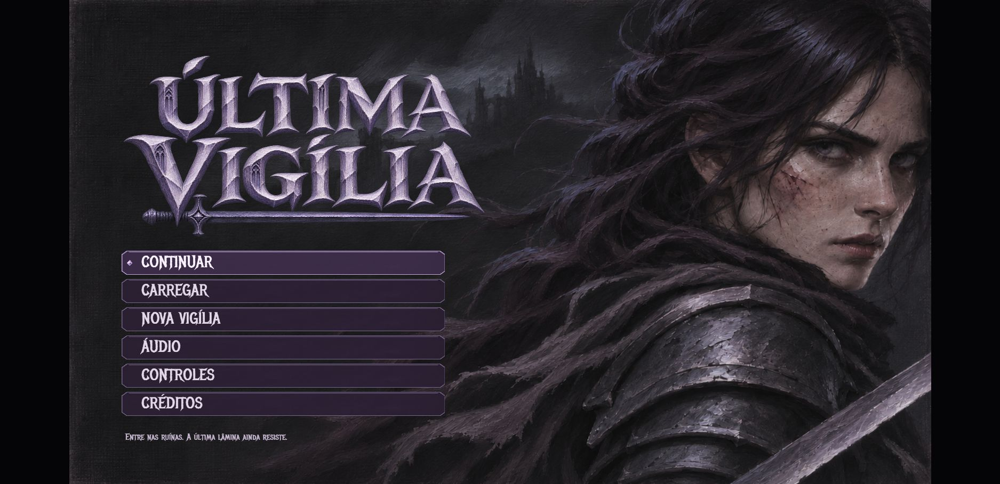
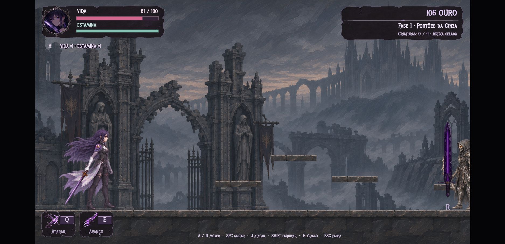
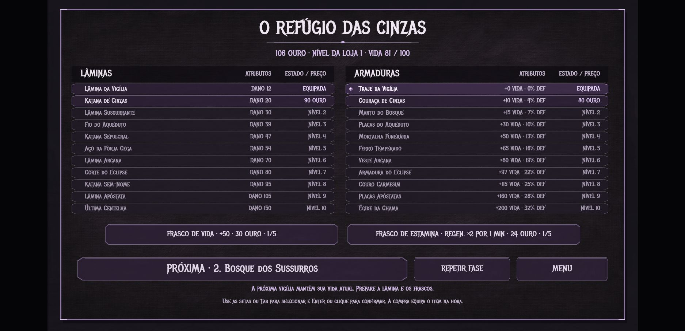
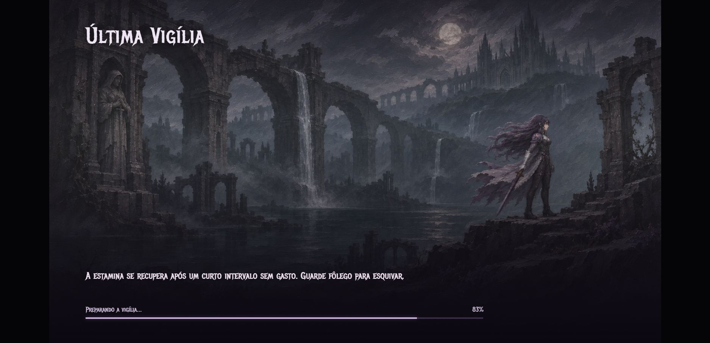

# Última Vigília

Jogo de ação e plataforma 2D com elementos de soulslike, ambientação de fantasia sombria e campanha de dez fases.

**Equipe:** Gustavo Pestana; Lucas Nascif; Mateus Ramos; Vitório Ribeiro.

- **[Jogar no navegador](https://pestana04.github.io/ultima-vigilia-web/)**
- [Repositório do jogo e histórico de desenvolvimento](https://github.com/Pestana04/ultima-vigilia-web)
- [Baixar o projeto editável completo do Construct 3 (.c3p)](https://github.com/Pestana04/ultima-vigilia-web/releases/download/revisao-49/Ultima-Vigilia-Revisao-49-Creditos-da-Vigilia.c3p)
- [Baixar imagens, músicas, vozes e efeitos da versão web](https://github.com/Pestana04/ultima-vigilia-web/releases/download/revisao-49/midia-revisao-49.zip)

## História e objetivo

A Chama da Vigília protegia uma vila de uma maldição capaz de transformar seus moradores em monstros. Quando o Usurpador rouba a Chama, uma espadachim parte pelas ruínas para recuperá-la antes que os habitantes percam o que resta de sua humanidade.

O jogador atravessa dez regiões, enfrenta os inimigos de cada área para liberar a arena e derrota seu guardião. Entre as fases, pode gastar o ouro obtido em armas, armaduras e frascos. A jornada termina no confronto com o Usurpador da Chama e no retorno à vila.

## Ferramentas utilizadas

- **Construct 3:** projeto editável da Revisão 49, com layouts, objetos, eventos, scripts e recursos.
- **JavaScript em módulos:** lógica de combate, animações, inimigos, chefes, progressão, menus, áudio e salvamento.
- **HTML5, CSS e WebGL:** adaptação independente para execução no navegador. O carregamento ilustrado foi acrescentado a esta versão web.
- **GitHub e GitHub Pages:** versionamento, distribuição dos arquivos e hospedagem jogável.
- **ChatGPT/Codex e ferramentas de IA:** assistência na implementação, revisão dos scripts, integração e produção de recursos, conforme os créditos abaixo.

A versão web reproduz a lógica da Revisão 49 por meio de uma camada própria de execução e renderização. O arquivo `.c3p` preserva o projeto para abrir e editar no Construct 3.

## Como jogar

Abra o **[link jogável](https://pestana04.github.io/ultima-vigilia-web/)** em um navegador com suporte a WebGL, no computador ou celular. A primeira abertura e a entrada em uma fase podem levar mais tempo enquanto os recursos são baixados. Não é necessário instalar o Construct para jogar no site.

### No celular

O jogo reconhece celulares e tablets com toque e mostra um direcional à esquerda e botões de ação à direita. É possível mover e atacar ao mesmo tempo com dedos diferentes. Segure Atacar para continuar os golpes; para descer de uma plataforma, puxe o direcional para baixo e toque Saltar.

Em **Controles**, no menu inicial ou na pausa, arraste os botões e toque **Salvar**. As posições ficam guardadas neste navegador, separadamente para horizontal e vertical. **Restaurar padrão** recupera a disposição original da orientação atual; **Cancelar** descarta o ajuste em andamento.

Há botões para pausa, interação, frascos e para pular a narração. Loja, saves, créditos e áudio possuem menus próprios para toque, com rolagem e alvos maiores. O botão de tela cheia funciona nos navegadores que oferecem esse recurso. A orientação horizontal é recomendada para visualizar melhor a arena; a vertical também tem uma disposição própria.

### Controles padrão

| Ação | Tecla / botão |
| --- | --- |
| Mover | A / D ou setas esquerda / direita |
| Saltar | Espaço, W ou seta para cima |
| Descer de uma plataforma | S ou seta para baixo junto de saltar |
| Atacar / combo | J ou clique esquerdo |
| Esquivar | Shift ou K |
| Aparar | Q |
| Avanço | E |
| Ultimate | R |
| Frasco de vida | H ou 1 |
| Frasco de estamina | 2 |
| Interagir com braseiro / escadaria final | F |
| Pausar / retomar | Esc |

As teclas podem ser alteradas em **Controles**, no menu inicial. Espaço permite pular as cenas narrativas. Os menus aceitam mouse, setas e Enter.

## Sistemas do jogo

- Combate com ataques, esquiva, aparo e gerenciamento de estamina.
- Inimigos com comportamentos e animações próprios; dez confrontos de chefe.
- Ultimate com transformação: a primeira ativação da campanha mostra a sequência completa; as seguintes usam uma versão curta. Durante a transformação, a estamina não é consumida nem recuperada.
- Loja de equipamentos e frascos entre as fases. O frasco de estamina dobra a recuperação passiva por um minuto.
- Chefe final com duas formas, ataques aéreos e convocação de reforços.
- Introdução, confronto final e epílogo narrados, com legendas e opção de pular.
- Continuação automática e dez slots de salvamento manual no menu de pausa.
- Ajustes de volume geral, voz, música e efeitos, com opção de silenciar cada categoria.
- Carregamento com três ilustrações, dicas e indicação de progresso.

Os saves, controles e volumes ficam armazenados localmente no navegador. Outro navegador ou dispositivo tem seu próprio progresso; limpar os dados do site remove esses registros. **Nova Vigília** reinicia a campanha atual; use os slots manuais para guardar campanhas.

## Instalação e execução local da versão web

É necessário **Python 3.10 ou superior**, conexão com a internet para obter os recursos na primeira preparação e um navegador com WebGL. O preparador utiliza apenas a biblioteca padrão do Python; não há pacotes de `pip` ou `npm` a instalar.

1. Baixe ou clone o código. No repositório de entrega do professor, abra a pasta `gustavo-pestana-lucas-nascif-mateus-ramos-vitorio-ribeiro`.
2. Abra um terminal na pasta que contém `index.html` e execute:

```bash
python preparar.py
python -m http.server 8000 --bind 127.0.0.1
```

3. Abra **http://127.0.0.1:8000/** no navegador. Mantenha o terminal aberto enquanto joga; pressione Ctrl+C para encerrar o servidor.

No Windows, caso o comando disponível seja `py`, use `py preparar.py` e `py -m http.server 8000 --bind 127.0.0.1`.

`preparar.py` baixa `midia-revisao-49.zip` (aproximadamente 274 MiB), confere seu SHA-256 e extrai as pastas `images/` e `files/`. Esses arquivos são distribuídos pela release do próprio jogo para evitar duplicar centenas de megabytes no repositório de entrega. O código-fonte web completo está nesta pasta; o pacote de mídia é uma dependência de execução.

Também é possível baixar o pacote pelo link acima e extraí-lo manualmente ao lado de `index.html`. A estrutura final deve conter `images/` e `files/` diretamente nessa pasta. Abrir o HTML por duplo clique (`file://`) não substitui o servidor HTTP, pois o jogo utiliza módulos e carregamento de arquivos.

## Abrir o projeto no Construct 3

Baixe o `.c3p` pelo link no início deste README. No [editor Construct 3](https://editor.construct.net/), use **Menu → Abrir → Arquivo** e selecione o projeto. Ele já contém seus recursos, layouts, eventos e scripts. Também é possível obtê-lo com `python preparar.py --construct`.

O arquivo `.c3p` tem aproximadamente 271 MiB. A abertura, edição e prévia no Construct dependem dos recursos disponíveis na conta e na versão do editor usada pelo avaliador. A versão hospedada pode ser jogada diretamente pelo link, sem conta no Construct.

## Organização do código

| Arquivo / pasta | Conteúdo |
| --- | --- |
| `index.html`, `style.css` | Página web e apresentação do carregamento |
| `boot.js` | Inicialização e carregamento dos recursos por fase |
| `runtime.js`, `renderer.js` | Camada de execução e renderização WebGL |
| `assets.json` | Manifesto de sprites, animações, objetos e camadas |
| `scripts/game-core.js`, `scripts/attacks.js` | Campanha e combate |
| `scripts/data.js` | Fases, inimigos, chefes e equipamentos |
| `scripts/principal.js` | Interface e integração dos sistemas |
| `scripts/*animation.js`, `scripts/*metrics.js` | Animações e medidas dos sprites |
| `scripts/save-slots.js`, `scripts/campaign-memory.js` | Salvamento e memória da campanha |
| `scripts/keybindings.js` | Configuração dos controles |
| `scripts/story-scenes.js` | Sequência narrativa e legendas |
| `scripts/music-player.js`, `scripts/hero-voice.js`, `scripts/sound-effects.js` | Música, falas e efeitos sonoros |
| `loading/` | Ilustrações, fonte e alternância das dicas |
| `touch/` | Detecção de dispositivo, direcional, botões, menus móveis e editor de posições |
| `docs/` | Capturas de tela, créditos e licença da fonte |
| `preparar.py`, `recursos.json` | Preparação local e identificação dos pacotes |

## Capturas de tela

### Menu inicial



### Exploração e combate



### Loja entre as fases



### Carregamento ilustrado



## Créditos e recursos de terceiros

- **Equipe:** Gustavo Pestana; Lucas Nascif; Mateus Ramos; Vitório Ribeiro.
- **Artes de personagens e cenários:** recursos desenvolvidos e refinados com assistência de ferramentas de geração de imagens, incluindo Rosebud e ImageGen. As ilustrações do carregamento foram produzidas com ImageGen seguindo a direção de arte do jogo.
- **Voz e narração da protagonista:** geradas com ElevenLabs.
- **Músicas:** [migfus20](https://opengameart.org/users/migfus20), com atribuição também nos créditos do jogo.
- **Sons de escudo e espada:** [StarNinjas](https://opengameart.org/users/starninjas), pacotes [10 Impact/Shield Blocks](https://opengameart.org/content/10-impactshield-blocks) e [20 Sword Sound Effects](https://opengameart.org/content/20-sword-sound-effects-attacks-and-clashes), CC0, com edição e composição para o jogo.
- **Outros efeitos:** gravações fornecidas para o projeto e efeitos editados ou criados para o jogo. Consulte [os créditos de áudio](docs/creditos-efeitos.txt), também incluídos no pacote de mídia.
- **Fonte:** Metal Mania, de Open Window, sob a [SIL Open Font License 1.1](docs/OFL-Metal-Mania.txt).
- **Inspirações de personagem:** Acheron e Blade, de Honkai: Star Rail.

O uso desses recursos é indicado para distinguir os materiais de terceiros do código e da integração do projeto. As licenças dos respectivos autores continuam aplicáveis; a publicação deste repositório não altera essas licenças.
